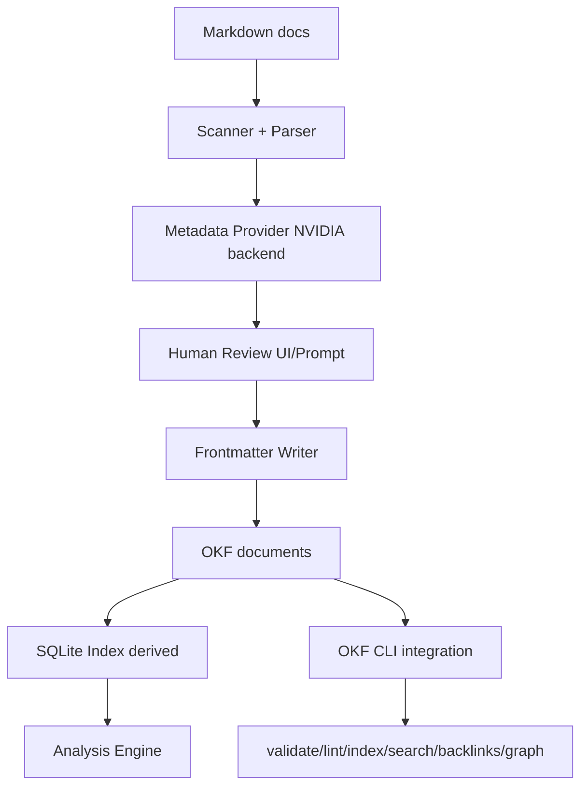

# kbmeta Design Document (v1)

## 1. Overview

kbmeta is a Rust CLI for technical Markdown knowledge bases where:

- OKF Markdown files (with YAML frontmatter) are the canonical source of truth.
- SQLite is a rebuildable analysis index.
- A local NVIDIA-backed model endpoint (for example self-hosted NIM) suggests semantic metadata only.
- A human must review and accept or edit metadata before write-back.

Design principle:

> LLM understands documents. OKF stores knowledge. SQLite analyses knowledge. Deterministic tools maintain structure.

## 2. Goals and Non-Goals

### Goals

- Provide a reliable CLI workflow for existing and new documents.
- Keep metadata edits explicit and review-driven.
- Build deterministic analysis on top of a rebuildable SQLite index.
- Integrate OKF tooling instead of reimplementing it.

### Non-Goals (v1)

- No automatic metadata acceptance.
- No autonomous file moves.
- No embeddings/vector DB/RAG.
- No cloud LLM dependency.

## 3. System Context



## 4. High-Level Module Design

Suggested source layout:

```text
src/
  main.rs
  cli.rs
  config.rs
  error.rs
  command/
    init.rs
    scan.rs
    suggest.rs
    analyse.rs
    find.rs
    tags.rs
    related.rs
    structure.rs
    rebuild.rs
    validate.rs
  document/
    mod.rs
    markdown.rs
    frontmatter.rs
    hashing.rs
    discovery.rs
  metadata/
    mod.rs
    model.rs
    normalize.rs
    review.rs
  provider/
    mod.rs
    trait.rs
    nvidia.rs
    llama_cpp.rs
    mock.rs
  okf/
    mod.rs
    cli.rs
  database/
    mod.rs
    schema.rs
    repo.rs
    rebuild.rs
  analysis/
    mod.rs
    tags.rs
    topics.rs
    related.rs
    structure.rs
```

Core traits:

```rust
pub trait MetadataProvider {
    fn suggest(&self, document: &Document) -> anyhow::Result<MetadataSuggestion>;
}

pub trait MetadataIndex {
    fn rebuild(&self, kb: &KnowledgeBase) -> anyhow::Result<()>;
}
```

## 5. Data Model

### 5.1 Frontmatter (source of truth)

Required fields in v1:

- type
- title
- description
- tags
- topics
- technologies
- languages

Additional derived/runtime fields are not stored in source unless explicitly accepted by user.

### 5.2 SQLite schema (derived index)

```sql
CREATE TABLE documents (
  id INTEGER PRIMARY KEY,
  path TEXT UNIQUE NOT NULL,
  title TEXT,
  description TEXT,
  doc_type TEXT,
  content_hash TEXT NOT NULL,
  mtime_utc TEXT,
  indexed_at_utc TEXT NOT NULL
);

CREATE TABLE tags (
  id INTEGER PRIMARY KEY,
  name TEXT UNIQUE NOT NULL
);

CREATE TABLE topics (
  id INTEGER PRIMARY KEY,
  name TEXT UNIQUE NOT NULL
);

CREATE TABLE technologies (
  id INTEGER PRIMARY KEY,
  name TEXT UNIQUE NOT NULL
);

CREATE TABLE languages (
  id INTEGER PRIMARY KEY,
  name TEXT UNIQUE NOT NULL
);

CREATE TABLE document_tags (
  document_id INTEGER NOT NULL,
  tag_id INTEGER NOT NULL,
  PRIMARY KEY (document_id, tag_id)
);

CREATE TABLE document_topics (
  document_id INTEGER NOT NULL,
  topic_id INTEGER NOT NULL,
  PRIMARY KEY (document_id, topic_id)
);

CREATE TABLE document_technologies (
  document_id INTEGER NOT NULL,
  technology_id INTEGER NOT NULL,
  PRIMARY KEY (document_id, technology_id)
);

CREATE TABLE document_languages (
  document_id INTEGER NOT NULL,
  language_id INTEGER NOT NULL,
  PRIMARY KEY (document_id, language_id)
);

CREATE TABLE relations (
  id INTEGER PRIMARY KEY,
  source_document_id INTEGER NOT NULL,
  target_document_id INTEGER NOT NULL,
  relation_kind TEXT NOT NULL,
  confidence REAL,
  reason TEXT
);

CREATE TABLE sources (
  id INTEGER PRIMARY KEY,
  document_id INTEGER NOT NULL,
  source_kind TEXT NOT NULL,
  source_ref TEXT,
  captured_at_utc TEXT NOT NULL
);
```

Notes:

- Keep schema minimal and normalized for deterministic queries.
- All tables are rebuildable from Markdown source plus deterministic analysis.

## 6. Key Workflows

### 6.1 Existing KB workflow

1. Discover Markdown files under configured document roots.
2. Parse frontmatter and compute content hash.
3. Detect missing or stale metadata.
4. For selected files, request metadata suggestion from provider.
5. Show review step (accept/edit/reject).
6. If accepted, write frontmatter and update index.
7. Run analysis reports.

### 6.2 New/changed document workflow

1. User runs `kbmeta suggest FILE`.
2. Parse file and call metadata provider.
3. Display proposal with diff-like view.
4. User chooses accept/edit/reject.
5. On accept, persist frontmatter and refresh SQLite entries for that file.

## 7. Command Semantics (v1)

- `kbmeta init`: Create `.kb/config.toml`, initialize SQLite schema.
- `kbmeta scan`: Scan documents, detect metadata gaps/staleness, optionally queue suggestions.
- `kbmeta suggest FILE`: Produce metadata suggestion and review flow for one file.
- `kbmeta analyse`: Run aggregate analysis reports.
- `kbmeta find ...`: Query indexed docs by tag/topic/text-like filters.
- `kbmeta tags`: Tag statistics and duplicates/inconsistencies.
- `kbmeta related FILE`: Show related-doc candidates from index relations.
- `kbmeta structure`: Orphans, suspicious placement, and basic structure findings.
- `kbmeta rebuild`: Recreate SQLite from documents.
- `kbmeta validate`: Delegate to OKF validation tooling.

## 8. Error Handling and Safety

- Never overwrite a document without explicit user confirmation in suggest flow.
- Write operations should be atomic (temp file + rename) for frontmatter updates.
- Rebuild must be idempotent.
- If SQLite is missing or corrupted, recreate from Markdown source.
- Provider failures must degrade gracefully with actionable error messages.

## 8.1 Provider Strategy (v1)

- Default metadata provider backend is NVIDIA model serving.
- Prefer local/self-hosted deployment to keep the no cloud dependency goal intact.
- Provider implementation stays behind `MetadataProvider` to allow later backends (including llama.cpp) without command-level changes.
- Add configuration keys for provider type, endpoint, model name, and request timeout.

## 9. Testing Strategy

### 9.1 Test layers

- Unit tests: frontmatter parsing, normalization, hash generation, schema repo functions.
- Integration tests: CLI commands against fixture KB directories.
- Golden tests: metadata suggestion rendering and review prompt formatting.
- End-to-end tests: init -> suggest -> accept -> rebuild -> analyse.

### 9.2 Fixture strategy

Use small fixture KBs:

- `fixtures/kb_minimal`
- `fixtures/kb_inconsistent_tags`
- `fixtures/kb_missing_frontmatter`
- `fixtures/kb_related_candidates`

## 10. Phased Implementation Plan

## Phase 1: Foundation and Deterministic Core

Goal:

- Deliver a working CLI skeleton with deterministic document ingestion and index rebuild.

Scope:

- CLI app scaffolding and command parsing.
- Config loading from `.kb/config.toml`.
- Markdown discovery and frontmatter parser.
- Content-hash generation.
- SQLite schema creation and `rebuild` implementation.
- `init`, `rebuild`, and basic `scan` command.

Test gates:

- `kbmeta init` creates `.kb/config.toml` and `.kb/index.sqlite`.
- `kbmeta rebuild` succeeds on fixture KB and is idempotent.
- Deleting `.kb/index.sqlite` then running `rebuild` restores full index.
- Hash changes when document content changes.
- Invalid frontmatter surfaces deterministic validation errors.

Exit criteria:

- Deterministic source -> index pipeline is stable with no LLM dependency.

## Phase 2: Metadata Suggestion and Human Review

Goal:

- Add NVIDIA-model metadata suggestion with explicit user review before persistence.

Scope:

- `MetadataProvider` trait and `nvidia` implementation.
- Suggestion JSON model and normalization rules.
- `suggest FILE` command.
- Accept/edit/reject interactive review flow.
- Safe frontmatter write-back on accept.
- `scan` integration for missing/stale metadata candidates.

Test gates:

- Provider output maps into internal `MetadataSuggestion` schema.
- Reject path performs zero file writes.
- Edit path writes exactly edited metadata.
- Accept path updates frontmatter and refreshes index for file.
- Provider timeout/failure returns actionable CLI error and non-zero exit.

Exit criteria:

- End-to-end manual metadata workflow works without automatic acceptance.

## Phase 3: Analysis and Query Commands

Goal:

- Deliver practical analysis outputs for quality and navigation.

Scope:

- `analyse`, `tags`, `related`, `structure`, and initial `find` command.
- Duplicate-tag and inconsistent-vocabulary detection.
- Unused tag and orphan detection.
- Basic relation scoring using deterministic heuristics (shared tags/topics).

Test gates:

- `tags` reports duplicates and unused tags on fixtures.
- `related FILE` returns deterministic candidate ordering for fixture data.
- `structure` flags orphans and suspicious placements.
- `analyse` produces stable summary metrics across repeated runs.

Exit criteria:

- Index-backed analytics provide clear, repeatable findings.

## Phase 4: OKF Tooling Integration and Hardening

Goal:

- Integrate existing OKF tooling and harden reliability for daily use.

Scope:

- `validate` command delegates to OKF CLI.
- Optional wrappers for OKF `lint/index/search/backlinks/graph`.
- Error taxonomy and improved diagnostics.
- Performance tuning for medium-sized KBs.
- Documentation and operator runbook.

Test gates:

- `kbmeta validate` correctly passes/fails based on OKF tool result.
- Integration tests verify command passthrough and error propagation.
- Rebuild + analyse performance budget met on representative fixture corpus.
- CLI help and docs cover all commands and expected outputs.

Exit criteria:

- kbmeta is production-usable for v1 workflow with clear operational behavior.

## 11. Release Readiness Checklist (v1)

- All phase exit criteria satisfied.
- Must-have scope from requirements implemented.
- Non-goals remain excluded.
- SQLite remains fully rebuildable.
- Human review is enforced for all metadata writes.
- Core commands documented with examples.

## 12. Risks and Mitigations

- LLM output variability: normalize aggressively and validate before display/write.
- Frontmatter format drift: strict parser + explicit error messages.
- Vocabulary fragmentation: canonicalization rules + duplicate/inconsistency reports.
- Tooling mismatch with OKF: isolate integration behind adapter module and smoke tests.
