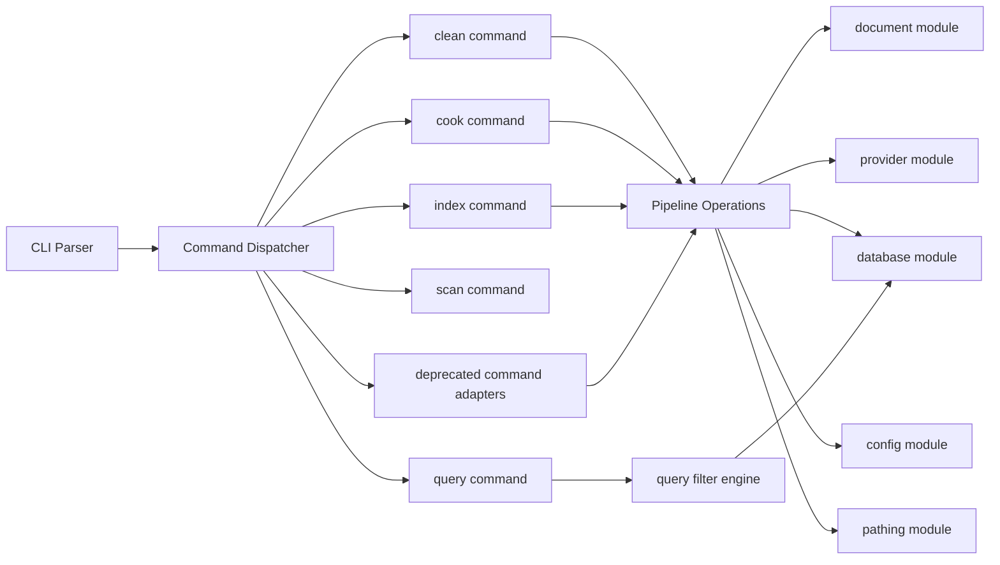
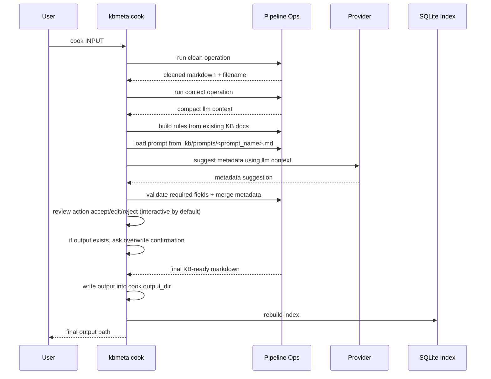
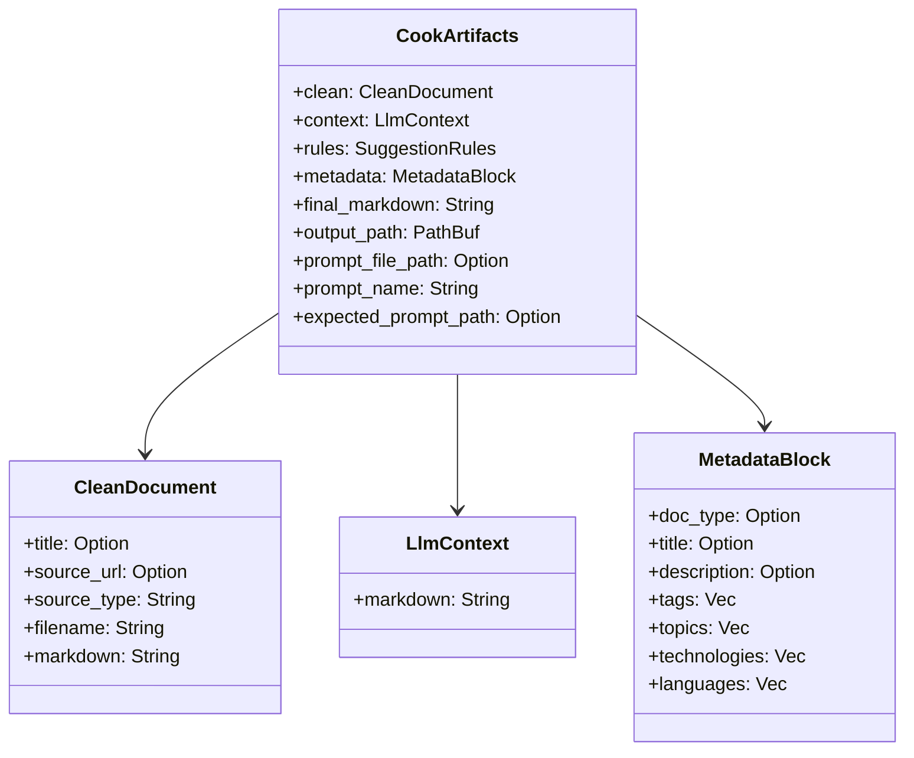
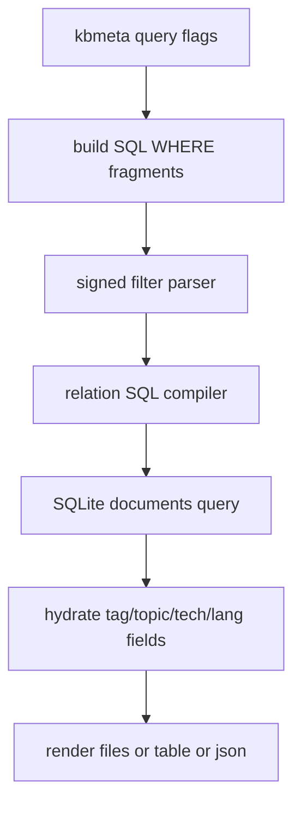
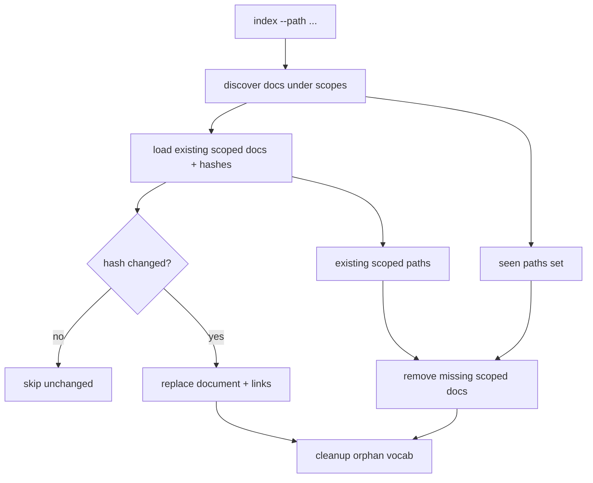

# kbmeta Pipeline Design

## Goals

- Make command internals composable so multi-step workflows do not duplicate logic.
- Keep only task-native commands in primary UX while preserving selected low-level tools for advanced use.
- Provide a one-shot command (`cook`) that produces KB-ready output without modifying input.
- Provide a single indexing command (`index`) that runs DB indexing and folder index generation.
- Keep all relative-path behavior deterministic by resolving from command `--root`.
- Keep LLM behavior configurable with root-local prompt files and safe fallback behavior.

## High-Level Organization



## Pipeline Operation Types

`src/pipeline/mod.rs` defines the abstract operation layer:

- `CleanOperation`
- `ContextOperation`
- `SuggestOperation`
- default implementations:
- `DefaultCleanOperation`
- `DefaultContextOperation`
- `DefaultSuggestOperation`

These abstractions let commands compose behavior rather than calling each other.

## Path Resolution Model

- All command inputs and config-derived relative paths resolve from `--root`.
- A shared helper (`pathing::resolve_from_root`) is used across command, pipeline, and config paths.
- Absolute paths are preserved as-is.

This prevents cwd-dependent behavior and keeps command execution deterministic.

## Cook Command Flow



  ## Init Command Flow

  ```mermaid
  sequenceDiagram
    participant U as User
    participant K as kbmeta init
    participant FS as Filesystem

    U->>K: init
    K->>FS: check .kb exists
    alt .kb exists and interactive tty
      K->>U: ask rewrite existing .kb?
      alt no
        K-->>U: skip init and keep existing state
      else yes
        K->>FS: remove .kb
        K->>FS: write fresh config and db
      end
    else .kb exists and non-interactive
      K-->>U: keep existing .kb (no rewrite)
    else .kb missing
      K->>FS: create .kb and defaults
    end
    K->>FS: ensure .kb/prompts/cook-default.md exists
  ```

## Data Shapes



## Command Policy

Primary native commands:

- `init`
- `cook`
- `index`
- `scan`
- `query`
- `clean`

Deprecated-but-compatible commands in Phase 1:

- `rebuild` (use `index`)
- `index-folders` (use `index`)
- `context` (use `cook`)
- `suggest` (use `cook`)

Deprecation policy:

- deprecated commands are hidden from top-level help
- deprecated commands remain runnable for one compatibility cycle
- invoking a deprecated command prints a migration warning
- Phase 2 removes deprecated command entry points

- `cook` is non-destructive for source input.
- `cook` defaults to interactive review (accept/edit/reject prompt).
- batch/non-interactive mode uses explicit `--accept` (or `-a`).
- in batch mode, reject/edit are intentionally unavailable.
- interactive edit uses editor configured in config (or environment fallback).
- if output collision occurs:
- interactive mode asks whether to overwrite.
- batch mode (`--accept`) fails fast with collision error.
- metadata is always canonicalized through provider rules.
- tag normalization applies in suggest path and cook path.
- hard post-model limits are enforced:
- tags max 10
- topics max 5
- optional intermediates are controlled by config (`keep_intermediate`).
- `--dry-run` is a global flag at CLI root and applies to mutation commands.

## Index Policy

- `index` is the native indexing entry point.
- `index` orchestrates:
- DB index refresh (full or scoped)
- folder `index.md` generation
- `index --path <dir>` can be repeated to reindex selected folders only.
- `index --rewrite` rewrites existing folder `index.md` files.
- when `--dry-run` is set globally, both indexing phases are preview-only.

## Query Policy

- `query` is read-only and uses indexed metadata from SQLite.
- default output is filenames only (root-relative), one per line.
- signed-filter expression syntax is shared across set-like fields:
- bare term => OR group
- `+term` => required (AND)
- `-term` => excluded (AND NOT)
- reusable signed-filter parser/compiler powers these flags:
- `--tag` / `-g`
- `--topic` / `-o`
- `--tech` / `-k`
- `--lang` / `-l`
- query supports output modes:
- `files` (default)
- `csv` (header + comma-separated rows)
- `table` (`path,title,type` default fields)
- `json` (all fields by default)



## Rebuild Engine Policy

- `rebuild` without scope remains full refresh behavior.
- `rebuild --path <dir>` can be repeated to reindex selected folders only.
- scoped paths are resolved relative to `documents_root` (unless absolute).
- scoped rebuild is incremental and cache-aware:
- unchanged documents are skipped when `content_hash` matches stored value.
- changed documents are reinserted with updated vocab links.
- removed files inside scope are pruned from `documents` and link tables.
- orphaned vocab entries are cleaned after scoped updates.



## Phase 2 Plan

- remove `rebuild`, `index-folders`, `context`, and `suggest` from CLI surface
- keep internal modules reusable for `cook` and `index`
- retain migration guidance in docs for one more release after removal

## Config Model

Top-level:

- `documents_root`: source discovery root
- `keep_intermediate`: optional artifact persistence
- `editor`: interactive edit command

Cook section (`[cook]`):

- `prompt_name`: prompt loaded from `.kb/prompts/<name>.md`
- `max_filename_len`: output filename stem cap
- `output_dir`: destination for kb-ready cooked documents

Provider section (`[provider]`):

- provider kind/runtime settings (`mock` or `nvidia` etc.)

Default separation:

- `documents_root = "knowledge/documents"`
- `cook.output_dir = "knowledge/staging"`

## Prompt Selection and Fallback

- `cook` attempts to load `.kb/prompts/<prompt_name>.md` from root.
- If found and non-empty, it is used as the system prompt body.
- If missing/empty, cook falls back to provider built-in default prompt.
- Runtime output prints which prompt source is being used, including expected missing path when fallback happens.

## Why This Structure

- Composition: one code path for reusable operations.
- Testability: each operation can be tested independently.
- UX: task-oriented native interface reduces command sprawl and confusion.
- Extensibility: new pipelines can be built by reusing operation traits.
