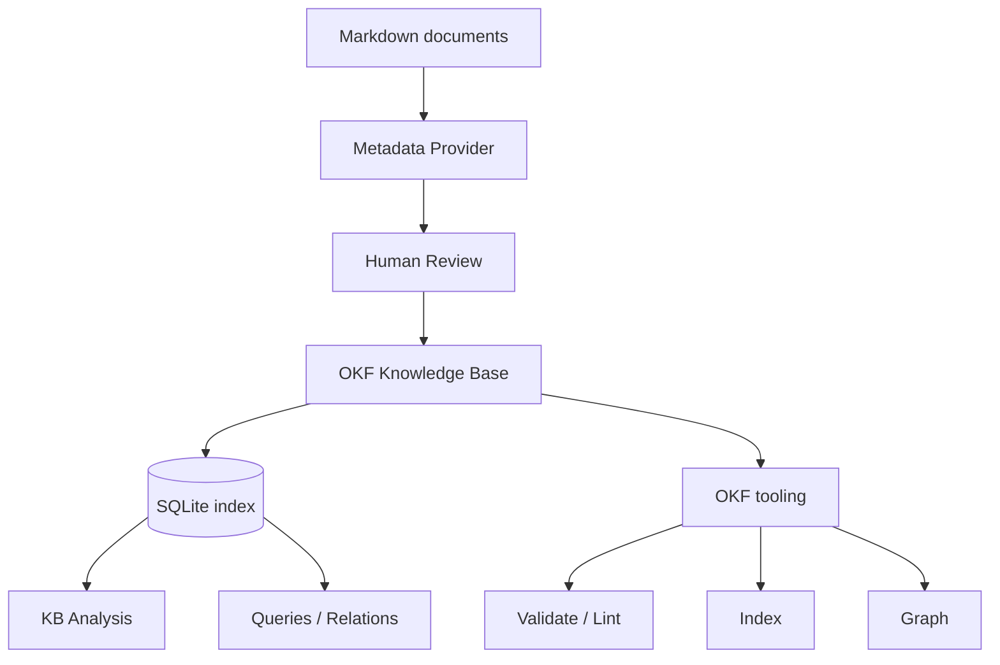
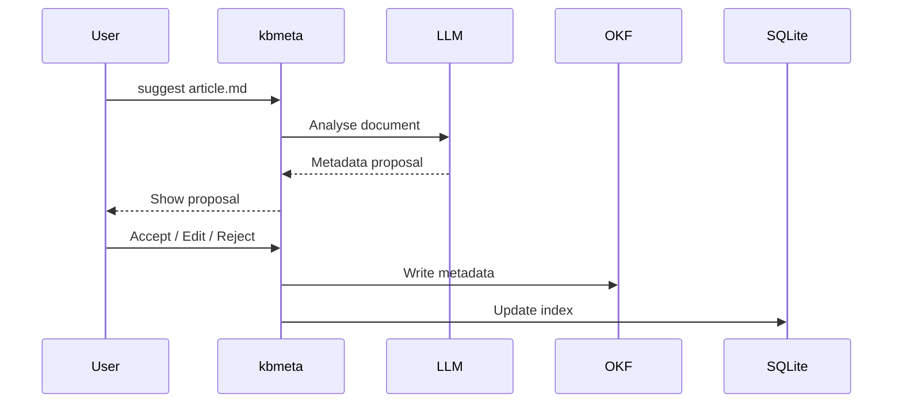
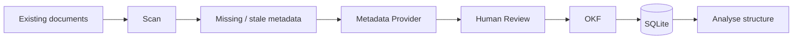

# Knowledge Base Metadata Tool — v1

## 1. Purpose

A lightweight Rust CLI for managing a technical Markdown knowledge base.

The tool has two workflows:

1. **Existing KB** — analyse and organise an existing collection.
2. **New input** — use a local LLM to suggest metadata for new or changed documents.

**OKF Markdown is the source of truth. SQLite is a derived index.**

---

## 2. Architecture



The LLM is used only for semantic metadata extraction.

---

## 3. Metadata Provider

The provider accepts a Markdown document and returns a structured suggestion:

```json
{
  "summary": "Short description of the document.",
  "tags": ["rust", "async", "tokio"],
  "topics": ["rust", "concurrency"],
  "technologies": ["Tokio"],
  "languages": ["rust"],
  "related": []
}
```

The suggestion is **never written automatically**.



---

## 4. OKF

OKF is the canonical document format.

A document contains Markdown with YAML frontmatter:

```yaml
---
type: Reference
title: Linux UIO
description: Userspace interface for simple Linux devices.
tags:
  - linux
  - uio
  - fpga
topics:
  - embedded-systems
  - operating-systems
technologies:
  - Linux
  - UIO
languages: []
---
```

The tool should use the existing OKF tooling for operations it already supports:

```text
validate
lint
index
search
backlinks
graph
```

The Rust application should not duplicate these unnecessarily.

---

## 5. SQLite

SQLite is a **rebuildable index**, not the source of truth.

Suggested entities:

```text
documents
tags
topics
technologies
languages
relations
sources
```

It supports:

* tag statistics;
* topic analysis;
* duplicate-tag detection;
* related-document queries;
* orphan detection;
* structure analysis.

Deleting SQLite must never lose knowledge-base content.

---

## 6. Existing KB



The tool should identify:

* documents without metadata;
* stale metadata;
* duplicate tags;
* inconsistent vocabulary;
* unused tags;
* possible related documents;
* misplaced or suspicious documents.

It should **suggest changes, not move files automatically** in v1.

---

## 7. New Documents

```bash
kbmeta suggest article.md
```

The user reviews the proposal.

After acceptance:

```text
article.md
    ↓
OKF metadata
    ↓
SQLite index
```

Changed documents are detected using a content hash.

---

## 8. CLI

Initial commands:

```bash
kbmeta init
kbmeta scan
kbmeta suggest FILE
kbmeta analyse
kbmeta find ...
kbmeta tags
kbmeta related FILE
kbmeta structure
kbmeta rebuild
kbmeta validate
```

`rebuild` regenerates the SQLite index from the OKF documents.

---

## 9. Storage

Recommended layout:

```text
knowledge/
├── documents/
├── indexes/
├── index.md
└── .kb/
    ├── config.toml
    └── index.sqlite
```

The `.kb` directory is generated/local state and can be recreated.

---

## 10. Rust Architecture

```text
src/
├── cli.rs
├── config.rs
├── document/
├── metadata/
├── provider/
│   └── llama_cpp.rs
├── okf/
├── database/
├── analysis/
└── index/
```

Core interfaces:

```rust
trait MetadataProvider {
    fn suggest(&self, document: &Document) -> Result<MetadataSuggestion>;
}

trait MetadataIndex {
    fn rebuild(&self, kb: &KnowledgeBase) -> Result<()>;
}
```

The LLM backend must remain replaceable.

---

## 11. v1 Scope

### Must have

* Rust CLI
* Markdown scanning
* OKF frontmatter
* local LLM metadata provider
* human review
* SQLite index
* content-hash tracking
* tag/topic analysis
* basic relationship analysis
* OKF validation integration

### Not in v1

* vector database
* embeddings
* RAG
* autonomous document movement
* automatic metadata acceptance
* cloud LLM requirement
* full OKF implementation

### Design principle

> **LLM understands documents. OKF stores knowledge. SQLite analyses knowledge. Deterministic tools maintain structure.**

